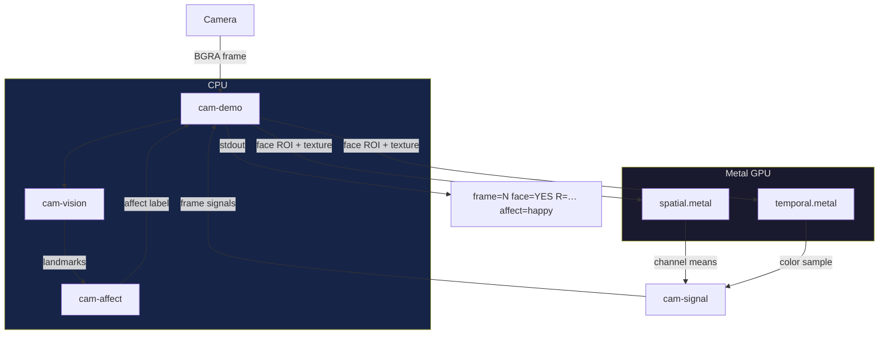

# CAM

CAM extracts affect signals from a live camera feed on macOS.
It runs face detection on CPU and color-channel analysis on GPU.

## Requirements

- macOS on Apple Silicon or Intel with a Metal-capable GPU
- A built-in or USB camera
- Nix with flakes enabled

The flake provides a development shell with Rust 1.91, macOS frameworks, and build tools.

## Build

```
nix develop -c cargo build --workspace
```

## Run

```
nix develop -c cargo run -p cam-demo
```

The demo captures frames from the default camera.
It prints one line per frame to stdout:

```
frame=0  face=YES  R=0.543 G=0.412 B=0.321  rPPG_g=0.412  affect=neutral
frame=1  face=NO  (skipped)
```

When no face appears in the frame, the system skips GPU work.
Press Ctrl+C to stop.

## Test

```
nix develop -c cargo run -p cam-test
```

The test creates a synthetic 128x128 BGRA frame with known pixel values.
It verifies the GPU pipeline against expected spatial means.
It does not need a camera.

## Architecture



The system splits work between CPU and GPU per frame.
Apple Vision runs face detection and landmark extraction on CPU.
Two Metal compute shaders run spatial and temporal analysis on GPU.
Both paths feed back into the demo binary for per-frame output.

## Affect Output

The system classifies each frame as `happy`, `sad`, or `neutral`.
Classification uses facial landmark geometry, not a trained model.
The output is a discrete label with no confidence score.

A frame with no detected face gets no label.
This is not the same as `neutral`.
`neutral` means a face is present and shows no target expression.

## Coordinate Convention

Apple Vision returns landmarks in bottom-left origin (0,0 = bottom-left).
All internal types use top-left origin (0,0 = top-left).
Conversion happens once, at the Vision boundary in `cam-vision`.
